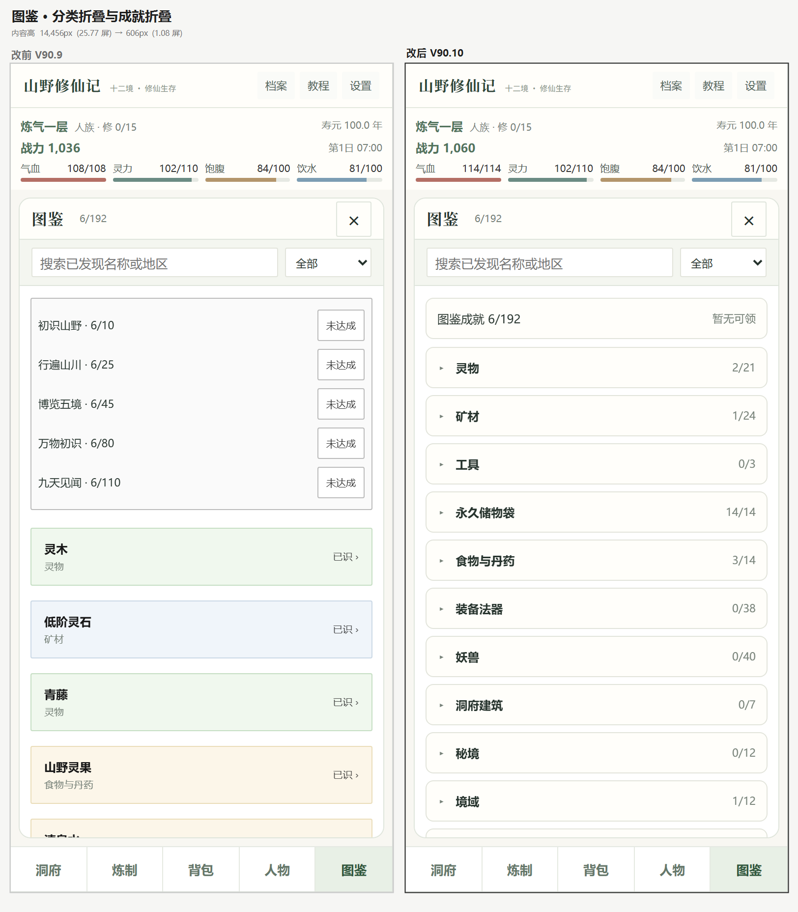
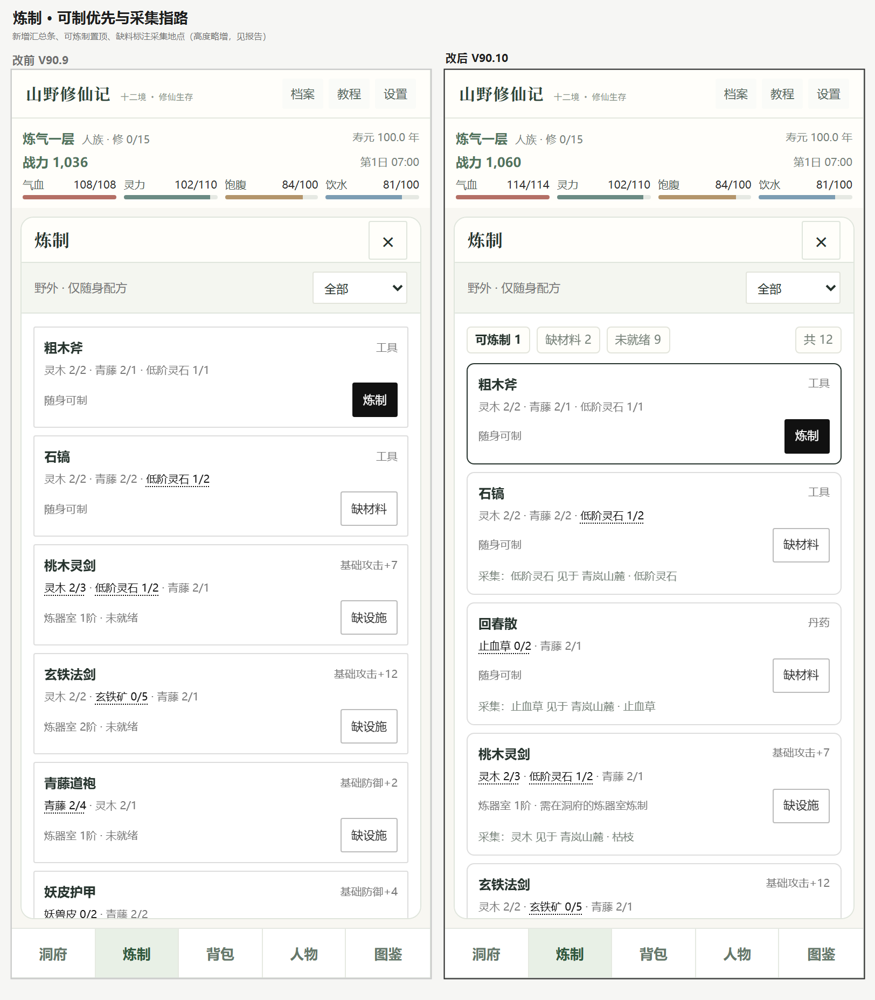
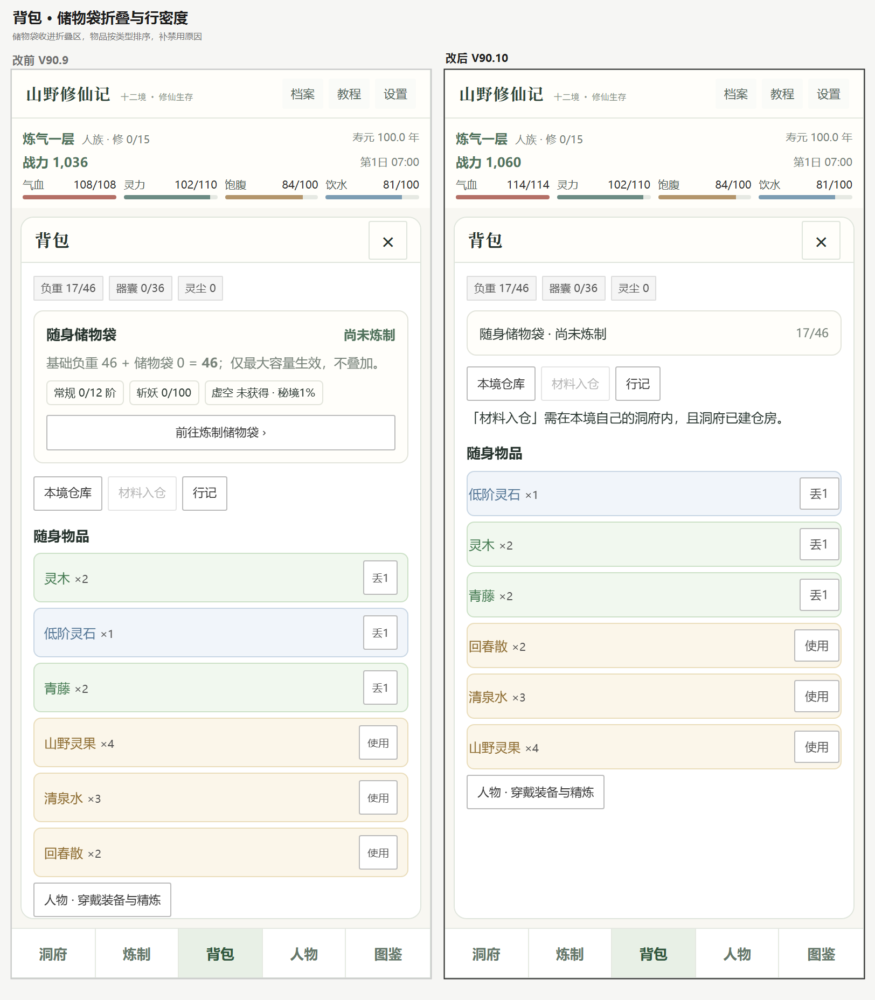

# V90.10 界面密度优化 · 前后对比

分支：`local/v910-ui-density`（基于 `local/v909-ui-progression-polish` 的 `fd1b5ac`）
基线：冻结的 V90.9 发布文件，SHA256 `E524AD54…FC22`（字节）/ `B728E687…458D`（LF）
产物：`releases/山野修仙记_V90.10_界面密度与检索优化版.html`，SHA256 `FC024760…1AC0`

## 量化对比（390×844，Chromium）

| 面板 | 内容高 V90.9 | 内容高 V90.10 | 屏数 | 变化 |
|---|---:|---:|---|---|
| **图鉴** | 14,456 px | **606 px** | 25.77 → **1.08** | **−95.8%** |
| 炼制 | 1,236 px | 1,410 px | 2.20 → 2.51 | +14%（见下） |
| 背包 | 619 px | 608 px | 1.02 → 1.00 | −1.8% |
| 设置 | 1,219 px | 1,219 px | 2.00 → 2.00 | 无变化 |
| 人物 / 洞府 / 主线 / 仓库 / 行记 / 教程 | — | — | 1.00 | 未改动 |

横向溢出：所有面板 **0**（改前改后均为 0，没有引入新溢出）。

## 1. 图鉴：25.77 屏 → 1.08 屏

改动：
1. **成就块折叠**：5 条 `D.BOOK_REWARDS` 收进 `
`，标题行显示「图鉴成就 6/192 · 暂无可领」，
   不再占用首屏 1/3。
2. **按类别分组折叠**：12 个类别（灵物 / 矿材 / 工具 / 永久储物袋 / 食物与丹药 / 装备法器 /
   妖兽 / 洞府建筑 / 秘境 / 境域 / 修炼 / 资源），每组 `
` 标题显示「已识/总数」。
3. **搜索或切换筛选时自动展开全部组**（`openAll = !!search || filter!=='all'`），
   保证检索不因为折叠而失效。
4. 条目行密度：`gap 10→7`、`padding 11/13→8/11`、`min-height 42`，标题 13px、副标题 10px。

未改变：条目点击行为（`book-open`）、成就领取（`claim-book`）、筛选与搜索逻辑。

## 2. 炼制：新增汇总条、可制优先、缺料指路

改动：
1. 顶部汇总条：`可炼制 1 / 缺材料 2 / 未就绪 9 / 共 12`。
2. **排序**：可炼制 → 缺材料 → 未就绪。可炼制卡片加深色边框强调。
3. **缺料指路**：复用 V90.9 已实现的 `progMatSource()`，从
   `D.RES → D.RESOURCE_LAYOUT → D.ZONES.map` 真实推导，例如
   「采集：低阶灵石 见于 青岚山麓 · 低阶灵石」、「采集：止血草 见于 青岚山麓 · 止血草」。
   **不虚构坐标**；推不出就不显示该行。
4. **状态文案具体化**：「炼器室 1 阶 · 未就绪」→「炼器室 1 阶 · 需在洞府的炼器室炼制」。

### 这里有个需要你判断的取舍

炼制内容高从 1,236 px **增加到 1,410 px（+14%）**。原因是每张缺料卡片多了一行采集指路。
换来的是「不用切到图鉴/地图去查材料在哪」。

如果更看重高度，可改为**只给第一张缺料卡片显示指路**，或指路只在点开卡片后显示，
预计可回到 1,236 px 左右。

## 3. 背包：储物袋折叠、按类型排序、禁用原因

改动：
1. **储物袋卡片折叠**为一行：`随身储物袋 · 尚未炼制` + `17/46`，展开后仍是原来的完整内容
   （基础负重公式、常规/斩妖/虚空进度、前往炼制入口）。
2. **物品按类型排序**：材料 → 食物丹药 → 工具 → 装备，同类按名称。
3. **禁用原因**：`材料入仓` 禁用时补一行「需在本境自己的洞府内，且洞府已建仓房」。
4. 物品行密度：`min-height 40→38`、行内按钮 30px。

未改变：`consume` / `discard` / `store` / `panel` 四个动作的行为与可用条件。

## 验证

| 项 | 结果 |
|---|---|
| JavaScript 语法（10 个 script 块） | 0 错误 |
| 自包含（无外链/远程资源） | 通过 |
| 六组核心回归 | PASS |
| 阶段指引专项 | PASS 121 断言 |
| 浏览器六视口 | PASS 51 项 |
| 构建断言 | 15 项（含「动作集合不得减少」） |
| 构建可复现 | 连续两次构建同 SHA256 |

> 构建脚本对三个被替换的函数逐处断言唯一命中，并校验 `data-a` 动作集合**不减少**，
> 从机制上防止「改了外观丢了功能」。

## 未做（建议下一轮）

- 功法（manualBody）：仍无分区标题
- 洞府（campBody）：144 字长段未拆
- 高境长文：大道 279 字、血脉 195 字、裂隙 167 字、因果 141 字
- 金丹雷劫 / 元婴问心的真实运行截图（需 zone≥5 存档）
